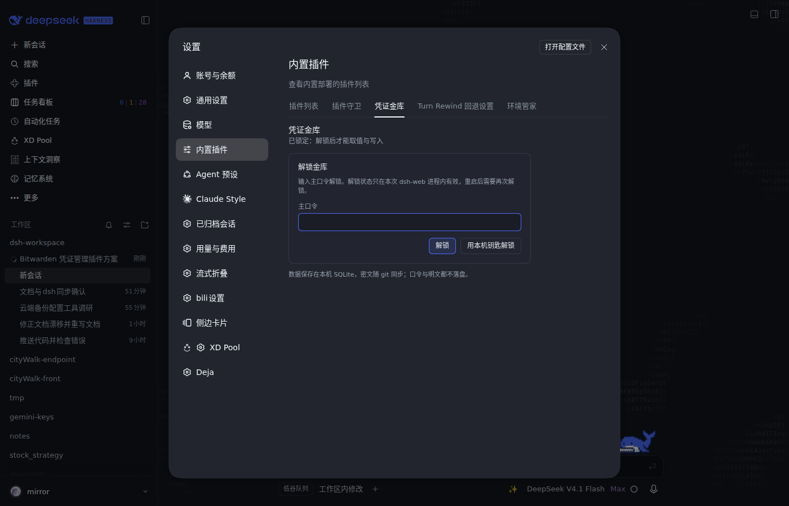

# dsh-bws

DSH Web GUI 里的**本地加密凭证金库**：口令派生密钥，密文落 SQLite，索引随 git 推到你自己的远端。

设置 → 内置插件 → **凭证金库**。



## 安装（DSH 用户）

前提：DSH `0.2.2` 或更高；Node `>= 24.9`（用到内置的 `node:sqlite`）。

```bash
git clone https://github.com/Mirror18/dsh-bws.git ~/src/dsh-bws
dsh plugin --profile <你的 profile> add "link:$HOME/src/dsh-bws"
# 重启 dsh web（host 侧代码要重启才生效）
systemctl --user restart dsh-web      # 或你自己的启动方式
```

刷新 Web GUI → 设置 → 内置插件 → **凭证金库** → 设主口令（会同时在本机写两个 0600 文件）。

不需要金库时：`dsh plugin --profile <profile> remove dsh-bws`。

命令行在 `~/.local/bin` 之外也能直接用：

```bash
node ~/src/dsh-bws/bin/dsh-bws.mjs --help
```

## 它解决什么

机器上原本散着多处明文：`~/.dsh/.credentials.yaml`、各项目的 `.env`、systemd unit 里的环境变量、`~/server-keys/*/secret.env`。dsh-bws 把这些收进一个金库，机器上只留密文。

- **没有云端依赖**：不联网也能解锁、取值；同步只在推送/拉取时发生。
- **没有主密码服务器**：口令只用于 `scrypt` 派生 32 字节密钥，不保存、不上传。
- **明文只在一次调用内出现**：面板「显示值」的那次响应，或 `dsh-bws run` 注入的那次子进程环境。不写日志、不落盘、不进会话记录。

## 分层与授权

金库里的条目按**分组**分层，分组分两级：

| 层级 | 默认权限 | 用途 |
|---|---|---|
| 通用层（`shared`） | 全员可读写 | 跨项目复用：token、ssh key、pem |
| 项目层（`project`） | 仅被授权的工作区 | 某个项目自己的数据库密码、JWT、云托管密钥 |

分组由用户在面板「授权」页**自己创建**（新库是 0 组 0 条）：建组 → 迁移或新建凭证时选分组。分组与授权都保存在金库里，随 git 同步。

授权页以**工作区为主**：每个工作区一行，点分组标签切换 无 / 只读 / 读写，**一个工作区可选多个分组**；另有「全部可读写 / 清空」一键操作。新出现的工作区会带「新」标记与「未授权」提示。删除还有凭证的分组会被拒绝。

> 授权是 DSH 内部的约束，不是密码学隔离——能读金库文件的人自然能拿到全部密文（还得有口令）。真正的硬隔离要靠多把口令 + 多份金库。

## 数据放在哪

```
$DSH_HOME/dsh-bws/            # 默认 ~/.dsh/dsh-bws
├── vault.db                  # SQLite：密文 + 元数据（0600）
├── config.json               # 远端 URL（不含凭据）
└── repo/                     # git 仓库：只有密文与元数据
    ├── meta/{kdf,groups,grants,index}.json
    └── secrets/<分组>/<KEY>.enc
```

`DSH_BWS_DATA_DIR` 可以整体改目录。

## 同步

远端可配一个或两个（面板默认给 `origin` / `gitee` 两个名字），在「同步」页填 URL 后推送/拉取；只填一个也行。

- 推送用的是**本机已有的 git 凭据**（SSH key 或 credential helper），插件不保存任何 git token，也不碰远端账号。
- 同一台机器 last-write-wins（按 revision）；两台机器改同一条时，拉取会报冲突并保留本地版本，需要人工择一。
- git 历史抹不掉：删掉的条目在旧提交里仍有密文。真正作废要**轮换**该密钥本身。

## 凭证规范 skill

插件启动时会把一份规范写到 `$DSH_HOME/skills/dsh-bws/SKILL.md`（内容变了才重写，skill provider 会热加载）。它规定了键名、备注格式（`type=/owner=/host=/consumer=/path=`）、放哪个分组、只用 `bws_run` 注入取值、新工作区如何用 `bws_grant` 接入、入库后清理明文与轮换边界——新项目照着做即可。

## 命令行

给脚本和 systemd 服务用（`bin/dsh-bws.mjs`，装了插件就是 `node_modules/.bin/dsh-bws`）：

```bash
dsh-bws list [--group <项目>] [--json]     # 键名/分组/备注，无值
dsh-bws groups                               # 分组与条数
dsh-bws has GITHUB_TOKEN                     # 存在则退出码 0
dsh-bws get GITHUB_TOKEN [--raw]             # 打印一条值
dsh-bws run --group <项目> -- ./service    # 注入环境变量后执行
dsh-bws run --file SSH_KEY -- ssh -i "$DSH_BWS_FILE_SSH_KEY" …   # 物化成 0600 临时文件
dsh-bws passwd                               # 改主口令（重新封装全部密文并写回本机钥匙与口令文件）
dsh-bws key path                             # 本机钥匙文件位置
dsh-bws key export --out <文件>              # 导出可搬运的钥匙（给另一台机器）
dsh-bws key import <文件>                    # 导入钥匙（先验能不能开库）
dsh-bws check                                # 校验本机钥匙/口令能否打开金库
```

解锁材料按优先级：`--key-file` → `~/.config/dsh-bws/key` → `--passphrase-*` → `DSH_BWS_PASSPHRASE` → TTY 提示。
数据目录：`--data-dir` → `$DSH_BWS_DATA_DIR` → `$DSH_HOME/dsh-bws` → `~/.dsh/dsh-bws`。

**钥匙落在本机**：面板里「创建金库」时会自动写两个 0600 文件——
`~/.config/dsh-bws/key`（解锁密钥，CLI 与服务优先用它，不需要口令）与
`~/.config/dsh-bws/passphrase`（口令备份）。已建过库的机器在解锁后会出现一行提示，点一下即补写。
可用 `DSH_BWS_KEY_FILE` / `DSH_BWS_PASSPHRASE_FILE` 改位置。
锁定态的口令门会多出「用本机钥匙解锁」（服务端读 key 文件，一次性解锁本进程）。

**多机（甲方案：搬钥匙，不搬仓）**：`dsh-bws key export --out <文件>` → 另一台机器
`dsh-bws key import <文件>`（导入前会先验证能不能开库，对不上 exit 3）→ 面板点「用本机钥匙解锁」。
钥匙文件等同于金库钥匙，用 scp / 密码管理器搬，别放进仓库。同一口令在所有机器通用
（盐与验证锚随仓库同步），改口令会重新封装全部密文，旧口令立即失效。

**自启动/无人在场**怎么取用（口令文件、systemd-creds、系统级 unit、ssh 隧道改法）见
[`docs/SERVICES.md`](docs/SERVICES.md)。

## 文档

- `docs/DEPLOY.md` —— 从零在新机器部署（含第二台机器的同步与换口令）。
- `docs/SERVICES.md` —— 让 systemd 服务 / 脚本在开机时取到凭证（含 ssh 隧道改法）。
- `docs/DETAIL.md` —— 面板各页做什么、密钥怎么来、安全边界。

## Agent 工具

装了插件后，会话里多三个工具（Host 侧注册，`lib/tools.js`）：

| 工具 | 做什么 | 边界 |
|---|---|---|
| `bws_list` | 列条目：键名、分组、备注、长度 | 只列调用方 workspace 有权读的分组；**不返回值** |
| `bws_run` | 把值注入环境变量，`bash -c` 执行一条命令，回 exit/stdout/stderr | 值不进参数、不进日志；被拒的键列在 `skipped` |
| `bws_grant` | 给一个工作区授权某个项目层分组（read / write / none） | 新建工作区后用它接入；通用层分组拒绝单独授权 |

权限用的是面板「授权」里那份配置：调用方 workspace 由 `exec.agent.session.header.cwd` 经 `workspaceRegistry.resolveByPath()`（async）解析，解析不到再按已注册工作区做最长路径前缀匹配。通用层默认可读写，项目层需要显式授权，否则工具报「没有权限读取这些凭证」。

**刻意不提供「把值交给模型」的工具。** 明文一旦回到会话，就会永久留在会话记录里，与这个插件存在的理由冲突。要让命令用上凭证就交给 `bws_run`；需要落地到文件就在命令里重定向。

## 路由（同源，仅 loopback Host）

| 路由 | 作用 |
|---|---|
| `GET /bws/status` | initialized / locked / 条数 / 远端 / 最近同步 / 空闲锁定分钟数 |
| `POST /bws/setup` | 首次建库（口令 ≥ 8） |
| `POST /bws/unlock` · `POST /bws/lock` | 解锁/锁定（解锁状态只在进程内） |
| `GET /bws/vault` · `GET /bws/groups` | 元数据索引（**无值**） |
| `POST /bws/groups/save` | 保存分组层级与授权 |
| `POST /bws/secret/<KEY>/reveal` | 取一次明文（未解锁 423） |
| `POST /bws/secrets` · `POST /bws/secret/<KEY>` · `POST /bws/secret/<KEY>/delete` | 新建/修改/删除 |
| `POST /bws/run` | 注入环境变量执行命令，返回 exit/stdout/stderr |
| `POST /bws/sync` · `POST /bws/remotes/save` | 推送/拉取、保存远端 |
| `POST /bws/import-bws` | 从 Bitwarden Secrets Manager 一次性迁移 |
| `POST /bws/config/save` | 面板设置（`autoLockMinutes` 0–240，0=关闭） |

空闲超过 `autoLockMinutes`（默认 15 分钟，可在面板「同步」页改）没有任何 `/bws/*` 访问时，服务端会自动 `lock()`；面板每 30 秒探一次状态，发现被锁就回到口令门。

写操作要求 `x-dsh-bws: 1` 头 + `application/json`（浏览器会先发 CORS 预检，跨站页面伪造不了）。宿主路由不在 `/api` 的 cookie 认证之后，所以还要求 Host 头是 loopback。

## 边界

- **argv 会进进程表**：`dsh-bws run` 的命令行本身对同机其他用户可见；值只走环境变量，所以别在命令行里 `echo $SECRET`。
- **解锁状态在进程里**：dsh-web 重启后要重新解锁；依赖它的服务需要在解锁后再启动。
- **口令丢了就没了**：没有找回通道。换口令 = 用新口令重建金库并重新导入。
- 不提供 TOTP、浏览器自动填充——那是个人保险库（`bw`）的事，本插件管的是机器上服务的凭证。

## 开发

无构建步骤：Host 是 ESM（`index.js` + `lib/`），客户端是手写的 `window.__ModuleLoader__` 模块（`client.js`）。

```bash
node --test test/          # 存储 / 同步 / 路由 / CLI
```

装法（开发时用链接）：

```bash
plugin_manager install_bundle target=link:/path/to/dsh-bws
systemctl --user restart dsh-web
```
